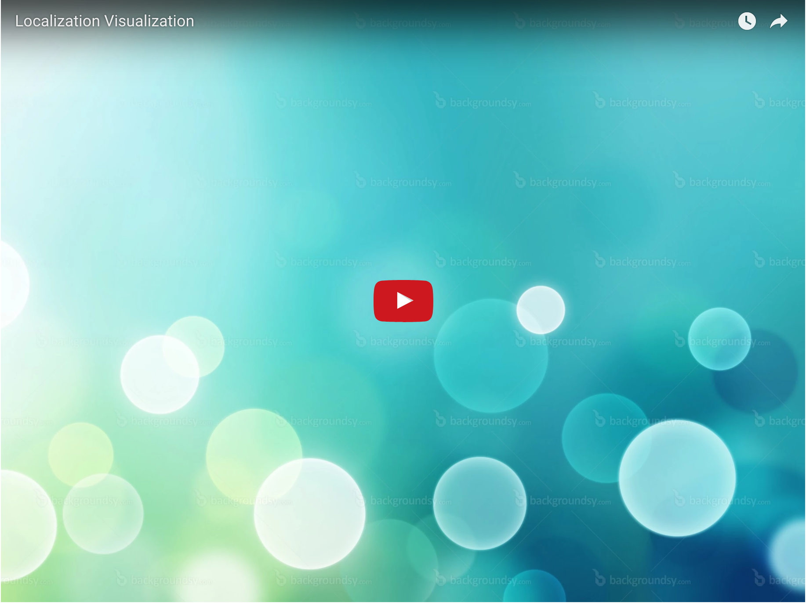

## Taylor's Localization Project


Robotic localization enables a robot to understand where it is positioned in relation to the world.

## Background

This project is intended to visualize a particle filter used in the process of localization described in the latter half of my corresponding research document, The Road to the Future: A Look at Autonomous Vehicles and the Localization Problem. The localization problem is representative of finding one’s self in space. This visualization project shows the robot, Tupac, in space, and the particles represent potential locations Tupac could reside. The more concentrated the particles the more likely that Tupac is in that position. In the real world there is no one overlooking Tupac that can determine his exact location, so this program provides an example on how robots like Tupac determine their location. The code is in working form and the controls can be seen below. Each particle measures how far it is from each POI. These measurements are then compared to Tupac’s measurements to determine a score and likelihood for that particle for being chosen for the next population.

## Controls

- ↑ – Increase sensing noise
- ↓ – Decrease sensing noise
- → – Increase movement noise
- ← – Decrease movement noise
- W – Increase ray count
- S – Decrease ray count
- V – Vector mode (experimental)
- Shift – Increase turning noise (wraps back to zero)
- Click – Toggle POI placement

## Usage
 – Mean error in pixels is in the upper right hand corner; lower is better
 – Left hand side is reserved for measurements
 – Click the canvas to focus it before using keyboard controls
 – Add at least three well-spaced POIs to constrain the position estimate

## Run and test

Serve this directory over HTTP (opening the HTML directly as a file cannot
fetch the Processing sketch):

```sh
python -m http.server 8000 --bind 127.0.0.1
```

Open `http://127.0.0.1:8000/` for the visualization and
`http://127.0.0.1:8000/tests.html` for the nine browser regression tests.
The tests compile the actual PDE source with the bundled Processing.js runtime.
They cover resampling ancestry, shared motion commands, wrapping, sensor/ray
controls, zero-noise likelihoods, ray intersections, and localization convergence.
Three seeded runs must reduce mean error by at least 90% and finish below 20 pixels.

## November 25, 2026: AI-assisted repair

Fixed invalid random headings, mismatched robot/particle motion commands,
resampling that overwrote its own parent population, negative coordinate and
heading wrapping, zero-noise division, likelihood underflow, noise propagation,
and removing a ray past the end of the readings list. Rays now intersect the
same square landmarks that are drawn, rather than invisible circles.

The existing Processing.js visualization is preserved. The page now scales to
its container, maps clicks back to simulation coordinates, and reports loading
errors explicitly. Instructions are collapsed to keep the canvas prominent.

This is a particle-filter demonstration, not a guarantee of localization.
The world wraps at its edges; POI ranges use direct Euclidean distances in
the displayed square. Ray mode remains experimental and sparse rays can be
ambiguous. With no POIs (or zero rays in ray mode), measurement resampling is
skipped. At zero sensing noise, observations are exact and likelihoods use a
0.25-pixel resolution floor to avoid division by zero.

## Publishing

GitHub Pages already publishes the `master` branch at
<https://taylorchasewhite.github.io/localization/>. Push tested changes there,
wait for the Pages deployment to succeed, and verify the live demo.

Embed that URL in WordPress, as shown in `notes.js`. Keep the runtime and PDE
inside the same iframe origin: the old direct canvas embed tried to fetch its
sketch across `www.old` and `old` hostnames and was blocked by CORS. The iframe
also works on the main site's React frontend, where injected post scripts do
not execute. The main site may cache WordPress content for up to an hour.

### Additional links
 - [Check out the project on TaylorChaseWhite.com](http://www.taylorchasewhite.com/robotic-localization-visualization/)
 - [](https://www.youtube.com/watch?v=5w84924gKxQ)
