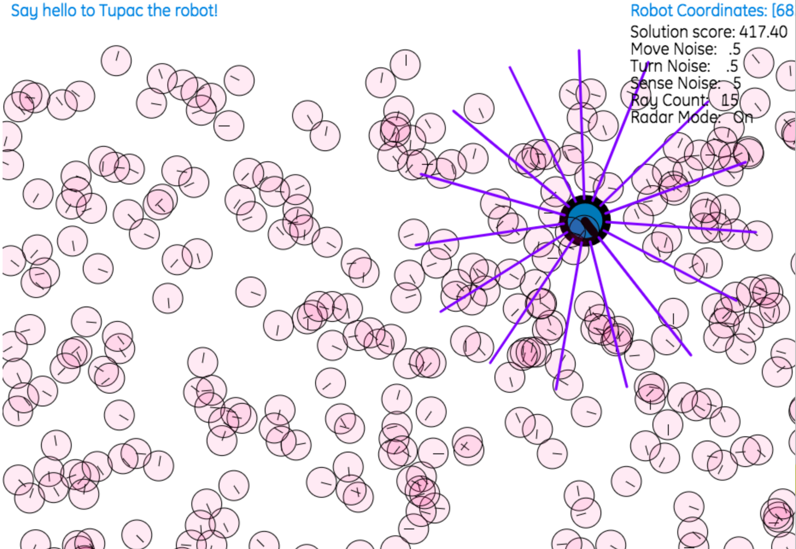

## Taylor's Localization Project


Robotic localization enables a robot to understand where it is positioned in relation to the world.

## Two editions, one experiment

- **[Classic](https://taylorchasewhite.github.io/localization/#classic)** is the
  existing, repaired Processing.js visualization. Its previous HTML is preserved
  byte-for-byte as `classic.html`; `web_localization.pde`, `processing.js`, and
  `localization.js` are unchanged by the 2026 upgrade.
- **[2026 Lab](https://taylorchasewhite.github.io/localization/#2026)** is a separate,
  dependency-free JavaScript implementation with a new instrument-panel interface.
- The edition switch is always above the simulation. Switching restarts that
  edition and unloads the other one, so two simulations never run in the
  background. The bare root URL still defaults to Classic; `#2026` opts into the
  new experience. Both editions also work directly at `classic.html` and
  `lab/index.html`.

### Inside the 2026 Lab

The new map is a bounded 10 x 7 meter warehouse with physical obstacles, not a
wrapping world. A simulated differential-drive robot follows a repeatable route.
The particle filter estimates position **and heading** from noisy odometry and:

- **Lidar:** ray intersections with the actual walls and storage blocks.
- **UWB:** ranges to four known radio anchors (twice the lidar noise setting).
- **Fused:** both sensor types; the default and least ambiguous configuration.

The interface includes pan/zoom, sensor and particle layers, an approximate
uncertainty ellipse, pose-error measurements, effective sample size (ESS), a
30-second convergence trace, measured p95 update cost, and actual animation FPS.
Population, noise, beams, and odometry uncertainty can be changed live.

Pause/Resume freezes or resumes the simulation; 1x/2x/4x changes the rate of fixed
100 ms updates. Replay uses seed 42 and retains your settings. **Relocate robot**
moves the simulated robot without resetting or informing the filter. Use it to
test recovery rather than just pressing Reset. With the map focused, Space
pauses, K relocates, and Escape fits the map. Reduced-motion users start paused.
Hidden browser documents do not advance the simulation.

### Model and limitations

Weights are accumulated in log space, with a robust, tempered lidar likelihood.
Systematic resampling runs only below 55% ESS, using separate parent/child
populations and small pose roughening. Sensor disagreement with the **predicted**
estimate introduces global recovery proposals; a single occlusion discontinuity
does not by itself mean the robot is lost. Typed arrays, analytic ray/rectangle
intersections, and separate simulation/render rates keep the update work bounded.

This is **known-map localization, not SLAM or production navigation**. Map,
calibration, and noise are idealized. The autopilot uses the simulator's true pose
to follow its route, but the filter receives only commanded odometry and sensor
readings, never the true pose. True pose is used separately to display error.
Rendered markers are smoothed; numerical metrics use the actual fixed-step state.
The ellipse approximates the dominant position mode, not a calibrated confidence
guarantee. Lidar alone can remain ambiguous, and UWB does not directly measure
heading. At zero sensor noise the likelihood retains a 2 cm resolution floor.

### 2026 validation

```sh
node --test lab/engine.test.mjs
```

Five test groups cover geometry, sustained convergence and relocation recovery,
zero/high noise across all sensor modes, safe resampling and live population
changes, deterministic replay, and a complete collision-free route.
Tests require final error below 12 cm, sustained tracking below 20 cm, and recovery
within 80 updates (including 10 consecutive accurate position/heading estimates).

Measured default configuration: 1,600 particles, 16 beams, 6 cm lidar noise,
fused sensing, 150 updates / 15 simulated seconds:

| Seed | Final position error | Final heading error | Sustained recovery after relocation |
| --- | --- | --- | --- |
| 1 | 0.48 cm | 0.05 degrees | 1.3 s |
| 42 | 1.62 cm | 0.39 degrees | 1.2 s |
| 123 | 0.66 cm | 0.28 degrees | 1.3 s |

Local Node 24 p95 update times were approximately 3.8-4.8 ms. A headless Edge
desktop run rendered at 60 FPS with approximately 7 ms p95 update cost.
These are measurements, not device-independent guarantees. Browser checks also
verified pause/resume, replay, live settings, relocation without a posterior
reset, zoom/pan/layers, both edition switches, startup, and no horizontal overflow
at 320, 375, 768, 1024, and 1440 pixels. All nine Classic browser tests still pass.
The editions use different maps, sensor models, and units: these results are not
a head-to-head accuracy benchmark against Classic.

## Background

This project is intended to visualize a particle filter used in the process of localization described in the latter half of my corresponding research document, The Road to the Future: A Look at Autonomous Vehicles and the Localization Problem. The localization problem is representative of finding one’s self in space. This visualization project shows the robot, Tupac, in space, and the particles represent potential locations Tupac could reside. The more concentrated the particles the more likely that Tupac is in that position. In the real world there is no one overlooking Tupac that can determine his exact location, so this program provides an example on how robots like Tupac determine their location. The code is in working form and the controls can be seen below. Each particle measures how far it is from each POI. These measurements are then compared to Tupac’s measurements to determine a score and likelihood for that particle for being chosen for the next population.

## Classic controls

- ↑ – Increase sensing noise
- ↓ – Decrease sensing noise
- → – Increase movement noise
- ← – Decrease movement noise
- W – Increase ray count
- S – Decrease ray count
- V – Vector mode (experimental)
- Shift – Increase turning noise (wraps back to zero)
- Click – Toggle POI placement

## Classic usage
 – Mean error in pixels is in the upper right hand corner; lower is better
 – Left hand side is reserved for measurements
 – Click the canvas to focus it before using keyboard controls
 – Add at least three well-spaced POIs to constrain the position estimate

## Run and test

Serve this directory over HTTP (opening the HTML directly as a file cannot
fetch the Processing sketch):

```sh
python -m http.server 8000 --bind 127.0.0.1
```

Open `http://127.0.0.1:8000/` for Classic, `http://127.0.0.1:8000/#2026` for the Lab, and
`http://127.0.0.1:8000/tests.html` for the nine browser regression tests.
The tests compile the actual PDE source with the bundled Processing.js runtime.
They cover resampling ancestry, shared motion commands, wrapping, sensor/ray
controls, zero-noise likelihoods, ray intersections, and localization convergence.
Three seeded runs must reduce mean error by at least 90% and finish below 20 pixels.

## November 25, 2026: AI-assisted repair

Fixed invalid random headings, mismatched robot/particle motion commands,
resampling that overwrote its own parent population, negative coordinate and
heading wrapping, zero-noise division, likelihood underflow, noise propagation,
and removing a ray past the end of the readings list. Rays now intersect the
same square landmarks that are drawn, rather than invisible circles.

The existing Processing.js visualization is preserved. The page now scales to
its container, maps clicks back to simulation coordinates, and reports loading
errors explicitly. Instructions are collapsed to keep the canvas prominent.

This is a particle-filter demonstration, not a guarantee of localization.
The world wraps at its edges; POI ranges use direct Euclidean distances in
the displayed square. Ray mode remains experimental and sparse rays can be
ambiguous. With no POIs (or zero rays in ray mode), measurement resampling is
skipped. At zero sensing noise, observations are exact and likelihoods use a
0.25-pixel resolution floor to avoid division by zero.

## Publishing

GitHub Pages already publishes the `master` branch at
<https://taylorchasewhite.github.io/localization/>. Push tested changes there,
wait for the Pages deployment to succeed, and verify the live demo.

Embed that URL in WordPress, as shown in `notes.js`. Keep the runtime and PDE
inside the same iframe origin: the old direct canvas embed tried to fetch its
sketch across `www.old` and `old` hostnames and was blocked by CORS. The iframe
also works on the main site's React frontend, where injected post scripts do
not execute. The main site may cache WordPress content for up to an hour.
The updated blog embed opts into `#2026`; the Classic tab remains available.

### November 25, 2026: AI-assisted 2026 edition

Added the new Lab without replacing the current simulation. The blog retains its
original article and Classic repair note, adds a dated upgrade note, and labels
the historical keyboard instructions as Classic controls.

### Additional links
 - [Check out the project on TaylorChaseWhite.com](http://www.taylorchasewhite.com/robotic-localization-visualization/)
 - [](https://www.youtube.com/watch?v=5w84924gKxQ)
